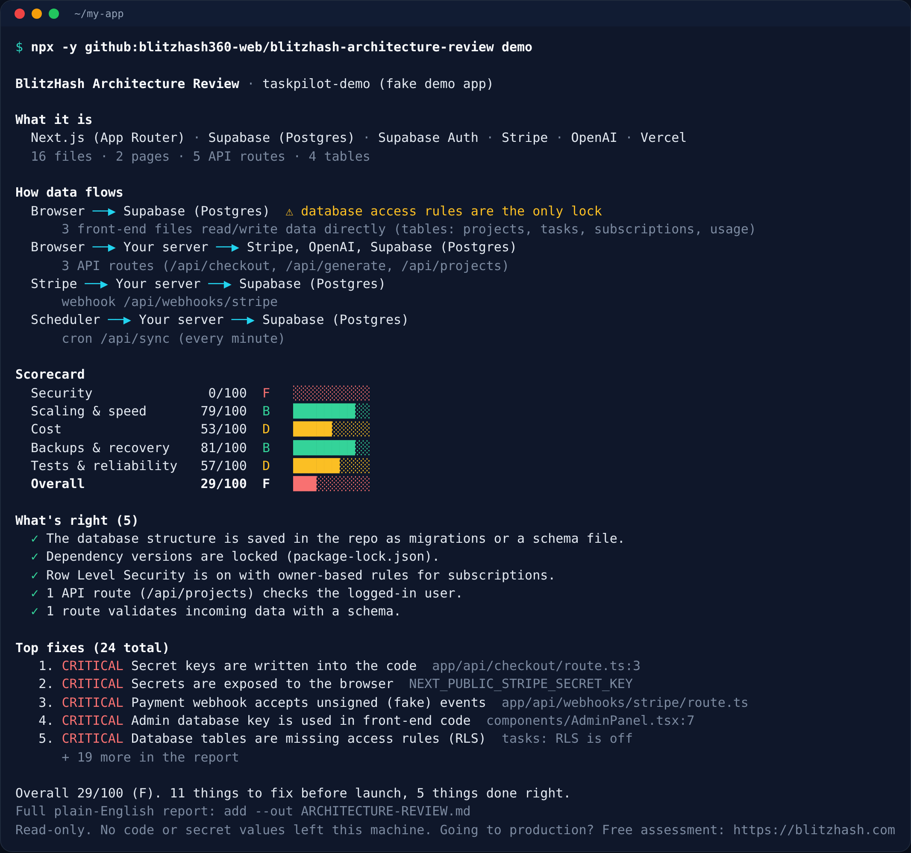

# BlitzHash Architecture Review

**Find out if your AI-built app is ready for real users: one command maps your stack and data flow, then writes a plain-English report with a scorecard, what's right, what's risky and what to fix first.**

[](LICENSE)
[](https://github.com/blitzhash360-web/blitzhash-architecture-review/actions/workflows/ci.yml)


[](https://github.com/blitzhash360-web/blitzhash-architecture-review/stargazers)


<sub>`npx -y github:blitzhash360-web/blitzhash-architecture-review demo` on a fake Next.js + Supabase + Stripe + OpenAI app with planted problems. Its keys are fake, and the output names the kind of key and where it is, never the value. Full report: [examples/sample-report.md](examples/sample-report.md).</sub>

## Quick start (3 steps)

```bash
# 1. Try it on a fake sample app (runs in a temp folder, touches nothing of yours)
npx -y github:blitzhash360-web/blitzhash-architecture-review demo

# 2. In your project folder: scorecard and top fixes in the terminal
npx -y github:blitzhash360-web/blitzhash-architecture-review

# 3. Write the full plain-English report, plus a founder-friendly HTML + SVG picture
npx -y github:blitzhash360-web/blitzhash-architecture-review --out ARCHITECTURE-REVIEW.md
# also writes ARCHITECTURE-REVIEW.html  (or pass --diagram picture.html)
```

Node 18.17+ and nothing else. No account, no API key, no network calls (the `npx` download aside). It never changes your code.

## Who it's for

You built the app with Lovable, Bolt, Replit, v0, Cursor or Claude Code. It works. Now real users, real payments or an investor are coming, and you'd like to know what a senior engineer would say before they do. This gives you that first pass in plain English: no jargon you have to look up, and for every problem a prompt you can paste straight into your AI tool.

## What the report contains

| Section | What you get |
|---|---|
| **Scorecard** | A score out of 100 and a grade for Security, Scaling & speed, Cost, Backups & recovery, Tests & reliability, plus an overall score (capped below 50 while any critical issue is open) |
| **What your app is built with** | Frontend, backend, database, auth, payments, AI, email, file storage, hosting, monitoring, and the builder (Lovable, Bolt, Replit) |
| **How data moves** | Who talks to whom: browser to database, browser to your API routes, webhooks, cron jobs, and outside services, as plain bullets and a Mermaid diagram GitHub renders |
| **Architecture picture (v1.1)** | A self-contained HTML + SVG diagram a non-engineer can follow: browser vs your server vs third parties, with the trust boundary and where secrets should live. Written automatically next to `--out`, or with `--diagram file.html`. No Mermaid needed to open it |
| **What's right** | What's already solid, so you know what not to touch |
| **What's risky** | Each finding with *what we found*, *why it matters*, *how to fix*, effort, file and line, and an *Ask your AI tool* prompt |
| **Prioritized fixes** | Fix before launch / Fix this month / Nice to have |
| **What this review can't see** | The honest limits of a static scan |

## What it checks

| Area | Checks |
|---|---|
| Security | Secret keys written in code (Stripe, OpenAI, Anthropic, AWS, GitHub, Slack, Supabase service_role, private keys, database URLs with passwords) · secrets behind `NEXT_PUBLIC_` / `VITE_` / `EXPO_PUBLIC_` prefixes · admin keys used in front-end code · `.env` committed or not git-ignored · Supabase tables without Row Level Security and `USING (true)` policies · Stripe webhooks that skip signature checks · API routes and cron jobs with no auth check · request bodies with no validation · no rate limiting · no security headers |
| Scaling & speed | Queries with no limit or pagination · database calls inside loops (N+1) · foreign key columns with no index · serverless Postgres with no connection pooler |
| Cost | AI endpoints anyone can call · AI calls with no max token cap · front-end polling every few seconds · every-minute cron jobs · oversized serverless function settings |
| Backups & recovery | Database schema saved as migrations · a written backup and restore plan or backup script · every env var listed in `.env.example` |
| Tests & reliability | Automated tests that actually run · CI on every change · error monitoring · TypeScript strict mode · a committed lockfile |

It understands Next.js (App Router and Pages), React + Vite (the Lovable and Bolt default), Remix, SvelteKit, Nuxt, Astro, Expo, Express, Fastify, Hono, NestJS, Supabase, Firebase, Prisma, Drizzle, MongoDB, Stripe, Lemon Squeezy, Paddle, OpenAI, Anthropic, Gemini, the Vercel AI SDK, Vercel, Netlify, Cloudflare, Docker, Railway, Render and Fly.io. Checks are heuristics: they point you at the right file, and you (or your AI tool) confirm.

## Use it from your AI agent

The included [`architecture-review` skill](skills/architecture-review/SKILL.md) has your agent run the scan, check each finding in the code, ask you the three questions code can't answer (live yet? ever restored a backup? spend caps?), explain the results in plain language and then fix one item at a time with your OK. It is read-only by default and is told never to print secret values.

```bash
# Preview (writes nothing), then install for Claude Code, Cursor and AGENTS.md tools
npx -y github:blitzhash360-web/blitzhash-architecture-review install-skill --target all
npx -y github:blitzhash360-web/blitzhash-architecture-review install-skill --target all --write
```

| Target | Writes |
|---|---|
| `claude` | `.claude/skills/architecture-review/SKILL.md` |
| `cursor` | `.cursor/rules/architecture-review.mdc` (agent-requested rule) |
| `agents` | `.agents/skills/architecture-review/SKILL.md` plus a short marked block in `AGENTS.md` (Codex, Jules, Amp and other AGENTS.md tools); the rest of your `AGENTS.md` is kept |

Then ask: *"Review the architecture of this app."*

## Commands

```text
arch-review [dir]                      scorecard + top fixes in the terminal
arch-review [dir] --out <file.md>      also write the full plain-English report
arch-review [dir] --md | --json        print the full report as Markdown, or raw results as JSON
arch-review demo                       review a built-in fake app
arch-review install-skill --target <claude|cursor|agents|all> [dir] [--write]

--fail-under <N>   exit 1 if the overall score is below N (CI gate)
--ignore <a,b>     skip folders (relative paths, comma-separated)
--top <N>          fixes listed in the terminal (default 6)
--no-git           skip the "is .env committed?" git check
```

Run it on every pull request with [`examples/github-action/arch-review.yml`](examples/github-action/arch-review.yml): it uploads the report and fails the check below the score you pick.

## Safety

- **Read-only.** It reads files, never edits them, never runs your code and never uses the network. The only file it writes is the report, and only when you pass `--out`.
- **No secret values, ever.** `.env` files are parsed for variable names only; values are dropped as each line is read. When a key is found in code, the report names the kind and the location (`app/api/checkout/route.ts:3 (Stripe secret key)`). Every line of output passes through a redaction step, and the CLI refuses to write a report that still matches a key pattern.
- Tests ([`test/review.test.mjs`](test/review.test.mjs)) run the full review on the fake demo app and assert none of its fake key values appear in the terminal, Markdown or JSON output.

## Going to production? What this doesn't cover

A static scan reads code. It can't log in, hit your APIs or open your dashboards, so before real users and real money arrive a senior engineer would also:

- Restore a real backup into a spare project and time it
- Load-test sign-up, checkout and your heaviest pages on staging
- Review settings that live only in dashboards: Supabase auth, storage buckets, DNS, Cloudflare and firewall rules
- Check your actual cloud and AI bills, plans and spend caps
- Walk through the business logic: prices, roles, refunds, the edge cases your users will find
- Scan dependencies and git history for known vulnerabilities and old keys

**Want a second pair of eyes?** BlitzHash does these reviews for AI-built apps. [Get a free assessment](https://blitzhash.com).

## Related BlitzHash tools

- [blitzhash-launch-ready-check](https://github.com/blitzhash360-web/blitzhash-launch-ready-check): score your live URL out of 100 (headers, exposed files, SEO basics)
- [supabase-rls-check](https://github.com/blitzhash360-web/supabase-rls-check): deeper Row Level Security check of your Supabase migrations
- [blitzhash-cloud-cost-cutter](https://github.com/blitzhash360-web/blitzhash-cloud-cost-cutter): find waste in your Vercel, Supabase and AWS usage exports
- [blitzhash-context-handoff](https://github.com/blitzhash360-web/blitzhash-context-handoff): one HANDOFF.md for the next AI tool or developer
- blitzhash-arch-diagrams: full architecture diagrams from your code (coming soon)

## Credits

Original BlitzHash work, MIT licensed, no third-party code and zero dependencies. The skill follows the [Agent Skills](https://agentskills.io) `SKILL.md` format; install targets follow the public docs for [Claude Code skills](https://docs.anthropic.com/en/docs/claude-code/skills), [Cursor rules](https://docs.cursor.com/context/rules) and [AGENTS.md](https://agents.md). Diagrams use [Mermaid](https://mermaid.js.org), which GitHub renders natively. Not affiliated with any tool or service named here.

---

Built by BlitzHash: need a senior team to check or scale your AI-built app? Free assessment at https://blitzhash.com


## Credits

The idea of a founder-friendly architecture picture was inspired by [cathrynlavery/diagram-design](https://github.com/cathrynlavery/diagram-design) (MIT). This repo does not include code from that project.
