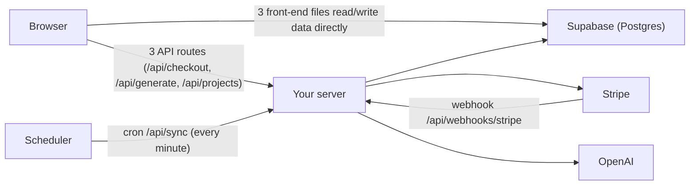

# Architecture review: taskpilot-demo (fake demo app)

> **Overall 29/100 (F). 11 things to fix before launch, 5 things done right.**
>
> A read-only review of the code in this folder, written for founders. Nothing was changed, nothing was sent anywhere, and no secret values are shown.

## Scorecard

| Area | Score | Grade | What we looked at |
|---|---|---|---|
| Security | 0/100 | F | keys, database access rules, logins on API routes, payment webhooks, rate limits, headers |
| Scaling & speed | 79/100 | B | unbounded queries, missing indexes, queries in loops, connection pooling |
| Cost | 53/100 | D | open AI endpoints, AI token caps, polling, cron frequency, function settings |
| Backups & recovery | 81/100 | B | schema in code, restore runbook, rebuildable settings |
| Tests & reliability | 57/100 | D | tests, CI, error monitoring, type safety, lockfile |
| **Overall** | **29/100** | **F** | capped below 50 because of 5 critical issues |

## What your app is built with

| Part | What we found |
|---|---|
| Frontend | Next.js (App Router) |
| Database | Supabase (Postgres) |
| Auth | Supabase Auth |
| Payments | Stripe |
| AI | OpenAI |
| Hosting | Vercel |

16 files reviewed · 2 pages · 5 API routes/functions · 4 database tables in migrations

## How data moves through your app

- **Browser → Supabase (Postgres)**: 3 front-end files read/write data directly (tables: projects, tasks, subscriptions, usage). ⚠️ database access rules are the only lock
- **Browser → Your server**: 3 API routes (/api/checkout, /api/generate, /api/projects), then Stripe, OpenAI, Supabase (Postgres)
- **Stripe → Your server**: webhook /api/webhooks/stripe, then Supabase (Postgres)
- **Scheduler → Your server**: cron /api/sync (every minute), then Supabase (Postgres)

All API routes and functions

| Route | File | Talks to |
|---|---|---|
| `/api/checkout` | `app/api/checkout/route.ts` | Stripe |
| `/api/generate` | `app/api/generate/route.ts` | OpenAI |
| `/api/projects` | `app/api/projects/route.ts` | Supabase (Postgres) |
| `/api/sync` | `app/api/sync/route.ts` | Supabase (Postgres) |
| `/api/webhooks/stripe` | `app/api/webhooks/stripe/route.ts` | Supabase (Postgres) |

## What's right (5)

- ✅ The database structure is saved in the repo as migrations or a schema file.
- ✅ Dependency versions are locked (package-lock.json).
- ✅ Row Level Security is on with owner-based rules for subscriptions.
- ✅ 1 API route (/api/projects) checks the logged-in user.
- ✅ 1 route validates incoming data with a schema.

## What's risky (24)

### Security

#### 🔴 Secret keys are written into the code (critical)

- **What we found:** 1 secret key written directly in code: Stripe secret key. (Values not shown.)
- **Why it matters:** Anyone who sees the code, the git history or the browser bundle can use these keys to take money, read data or run up your bills.
- **How to fix:** Rotate (replace) each key in the provider dashboard today, then load the new one from an environment variable on the server only. *(effort: under an hour)*
- **Where:** `app/api/checkout/route.ts:3 (Stripe secret key)`
- **Ask your AI tool:** "Move every hardcoded API key in this project into server-only environment variables, read them with process.env, and list which keys I must rotate in each provider dashboard."

#### 🔴 Secrets are exposed to the browser (critical)

- **What we found:** NEXT_PUBLIC_STRIPE_SECRET_KEY has a public prefix, so the value is copied into the JavaScript every visitor downloads.
- **Why it matters:** Public prefixes (NEXT_PUBLIC_, VITE_ and similar) mean "ship this to the browser". A secret there is a secret on the internet.
- **How to fix:** Rename it without the prefix, use it only in server code (API routes, server actions, edge functions), and rotate the old value. *(effort: under an hour)*
- **Where:** `NEXT_PUBLIC_STRIPE_SECRET_KEY`
- **Ask your AI tool:** "These env vars are secrets but have a public prefix: NEXT_PUBLIC_STRIPE_SECRET_KEY. Move their usage to server-only code, rename them without the prefix, and tell me which keys to rotate."

#### 🔴 Payment webhook accepts unsigned (fake) events (critical)

- **What we found:** 1 webhook accepts events without checking the signature: /api/webhooks/stripe.
- **Why it matters:** Anyone who finds the URL can send a fake "payment succeeded" event and unlock paid features for free.
- **How to fix:** Verify every event with the provider's signing secret (for Stripe: stripe.webhooks.constructEvent with the raw body and STRIPE_WEBHOOK_SECRET). *(effort: under an hour)*
- **Where:** `app/api/webhooks/stripe/route.ts`
- **Ask your AI tool:** "Update my Stripe webhook route to read the raw request body and verify it with stripe.webhooks.constructEvent and STRIPE_WEBHOOK_SECRET, returning 400 on failure."

#### 🔴 Admin database key is used in front-end code (critical)

- **What we found:** Front-end code refers to an admin/service key in 1 file.
- **Why it matters:** The service role (admin) key skips every access rule. If it reaches the browser, any visitor can read, change or delete all data.
- **How to fix:** Use the admin key only in server code. In the browser, use the public anon key plus database access rules (RLS). *(effort: a few hours)*
- **Where:** `components/AdminPanel.tsx:7`
- **Ask your AI tool:** "Find every place the Supabase service_role / admin key is used in browser code. Move that logic into a server route or edge function that checks the logged-in user, and use the anon key on the client."

#### 🔴 Database tables are missing access rules (RLS) (critical)

- **What we found:** 2 tables without Row Level Security and 1 policy open to everyone. The browser queries the database directly.
- **Why it matters:** Your public anon key is in every visitor's browser. Without RLS (or with "true" policies), anyone can use it to read or change those tables.
- **How to fix:** Turn RLS on for every table and write policies that compare the row owner to auth.uid(). *(effort: a few hours)*
- **Where:** `tasks: RLS is off (supabase/migrations/20261001120000_init.sql:9)`, `usage: RLS is off (supabase/migrations/20261001120000_init.sql:21)`, `projects: policy "anyone can do anything" lets anyone do anything (supabase/migrations/20261001120000_init.sql:29)`
- **Ask your AI tool:** "Write a Supabase migration that enables row level security on these tables: tasks, usage, and replace any USING (true) policies with owner-based policies using auth.uid()."

#### 🟠 .env file is not protected from git (high)

- **What we found:** .env exists but .gitignore does not exclude .env files.
- **Why it matters:** One "commit all" and your keys are in git history for good.
- **How to fix:** Add `.env*` and `!.env.example` to .gitignore before the next commit. *(effort: under an hour)*
- **Where:** `.gitignore`
- **Ask your AI tool:** "Update .gitignore so .env files are never committed, keeping .env.example."

#### 🟠 API routes don't check who is calling (high)

- **What we found:** 3 of 4 API routes never check for a logged-in user or secret, 3 of them change data, charge money, call AI or run as a cron job.
- **Why it matters:** Your API routes are public URLs. Without a login (or cron secret) check, anyone can call them, as often as they like.
- **How to fix:** At the top of each route, get the current user and return 401 if there is none. Cron routes should require a secret header (e.g. CRON_SECRET). *(effort: a few hours)*
- **Where:** `/api/checkout (app/api/checkout/route.ts)`, `/api/generate (app/api/generate/route.ts)`, `/api/sync (app/api/sync/route.ts)`
- **Ask your AI tool:** "Add an authentication check to these API routes: /api/checkout, /api/generate, /api/sync. Return 401 when there is no logged-in user; for cron routes, require the CRON_SECRET bearer token."

#### 🟠 No rate limits on public endpoints (high)

- **What we found:** No rate limiting found in the code or dependencies.
- **Why it matters:** Bots can hammer login, sign-up, AI and other endpoints thousands of times a minute, which leads to account takeovers, spam and surprise bills.
- **How to fix:** Add a per-IP and per-user limit to auth, AI and write endpoints (e.g. Upstash Ratelimit, Arcjet, or your host's firewall rules). *(effort: a few hours)*
- **Ask your AI tool:** "Add rate limiting to my API routes (especially auth, AI and anything that writes data) using @upstash/ratelimit, keyed by user id or IP, returning 429 when exceeded."

#### 🟡 Incoming data is not validated (medium)

- **What we found:** 2 routes use request data without validating it: /api/checkout, /api/generate.
- **Why it matters:** Unchecked input is how bad data, crashes and injection bugs get in. AI-written routes often trust whatever the browser sends.
- **How to fix:** Describe the expected shape with a schema library like Zod and reject anything else with a 400. *(effort: a few hours)*
- **Where:** `app/api/checkout/route.ts`, `app/api/generate/route.ts`
- **Ask your AI tool:** "Add Zod validation to the request body of /api/checkout, /api/generate and return 400 with a clear message on invalid input."

#### ⚪ No security headers (low)

- **What we found:** No security headers (Content-Security-Policy, X-Frame-Options, HSTS) are set in the app or host config.
- **Why it matters:** Headers are a cheap extra lock against clickjacking and injected scripts. Security reviews and enterprise customers check for them.
- **How to fix:** Add a headers block in next.config / vercel.json / netlify.toml (or helmet for Express). *(effort: under an hour)*
- **Ask your AI tool:** "Add security headers (Strict-Transport-Security, X-Frame-Options DENY, X-Content-Type-Options nosniff, Referrer-Policy, and a starter Content-Security-Policy) to this app's config."

### Scaling & speed

#### 🟡 Missing indexes on linked columns (medium)

- **What we found:** 2 link columns between tables have no index.
- **Why it matters:** Postgres does not index foreign keys for you. Every "show my items" query scans the whole table, and RLS policies on these columns get slow fast.
- **How to fix:** Add an index on each column listed (one line of SQL each). *(effort: under an hour)*
- **Where:** `projects.owner_id (supabase/migrations/20261001120000_init.sql)`, `tasks.project_id (supabase/migrations/20261001120000_init.sql)`
- **Ask your AI tool:** "Write a migration adding indexes on these foreign key columns: projects.owner_id, tasks.project_id."

#### 🟡 Queries fetch every row (no pagination) (medium)

- **What we found:** 3 queries fetch every matching row with no limit.
- **Why it matters:** Fine with 50 rows, slow and expensive with 50,000. Pages get slower every week as data grows, and database egress costs rise.
- **How to fix:** Add .limit()/.range() (or take/skip) and paginate lists. Select only the columns you show. *(effort: a few hours)*
- **Where:** `app/dashboard/page.tsx:10`, `app/dashboard/page.tsx:13`, `app/page.tsx:10`
- **Ask your AI tool:** "Find database queries with no limit and add pagination (.range for Supabase, take/skip for Prisma), selecting only the columns the UI uses."

#### 🟡 Database calls inside loops (medium)

- **What we found:** 1 place run a database or network call once per item inside a loop.
- **Why it matters:** 20 items means 21 round trips. Pages that feel fine today get slower in step with your data, and connection limits are hit sooner.
- **How to fix:** Fetch everything in one query (a join, `.in('id', ids)`, or include/select relations) instead of one per item. *(effort: a few hours)*
- **Where:** `app/dashboard/page.tsx:13`
- **Ask your AI tool:** "Find database calls inside loops in this project and rewrite them as a single batched query (joins or .in()), keeping the same result."

### Cost

#### 🟠 Anyone can spend your AI credits (high)

- **What we found:** 1 AI endpoint can be called by anyone, with no login check.
- **Why it matters:** Strangers (and bots) can use your AI credits for their own work. This is one of the most common surprise bills for AI-built apps.
- **How to fix:** Require login on AI routes, add a per-user daily limit, and set a hard monthly spend cap in the AI provider dashboard. *(effort: a few hours)*
- **Where:** `/api/generate (app/api/generate/route.ts)`
- **Ask your AI tool:** "Protect my AI routes: require a logged-in user, add a per-user daily request limit, and return 429 when it is reached."

#### 🟡 AI responses have no length cap (medium)

- **What we found:** 1 file call an AI model with no maximum output length.
- **Why it matters:** You pay per token. Without a cap, one long answer or a looping prompt costs many times what you planned.
- **How to fix:** Set max_tokens / maxOutputTokens on every call and pick the smallest model that does the job. *(effort: under an hour)*
- **Where:** `app/api/generate/route.ts:7`
- **Ask your AI tool:** "Add a sensible max output token limit to every AI model call in this project and tell me where a cheaper model would do."

#### 🟡 Browser polls the server every few seconds (medium)

- **What we found:** The browser re-fetches data on a short timer in 1 place.
- **Why it matters:** Every open tab calls your server or database every few seconds, even when nothing changed. 100 users polling every 2s is about 4 million requests a day.
- **How to fix:** Use realtime subscriptions or webhooks, poll only while the tab is visible, or poll much less often. *(effort: a few hours)*
- **Where:** `app/page.tsx:11 (every 2s)`
- **Ask your AI tool:** "Replace the setInterval polling in my front end with Supabase realtime (or poll only when the tab is visible, at most every 30 seconds)."

#### ⚪ Cron job runs every minute (low)

- **What we found:** /api/sync runs every minute.
- **Why it matters:** A job every minute is about 43,000 runs a month, each one a billable function call and usually a database query.
- **How to fix:** Run it hourly or daily if that is enough, or trigger it from an event (webhook, database trigger) instead. *(effort: under an hour)*
- **Where:** `vercel.json`
- **Ask your AI tool:** "Review my cron jobs in vercel.json and suggest the slowest schedule that still works, or an event-driven alternative."

#### ⚪ Oversized serverless function settings (low)

- **What we found:** Functions configured with long timeouts or large memory: app/api/generate/route.ts (300s 3009MB).
- **Why it matters:** Serverless is billed by memory x time. Oversized settings multiply the cost of every call, including failed ones.
- **How to fix:** Use defaults unless a function truly needs more, and move long jobs to a queue or background worker. *(effort: under an hour)*
- **Where:** `vercel.json`
- **Ask your AI tool:** "Check the functions config in vercel.json and right-size maxDuration and memory for each function."

### Backups & recovery

#### 🟠 No written backup and restore plan (high)

- **What we found:** No backup script or written restore steps were found.
- **Why it matters:** Backups you have never restored are a guess. When data is deleted by mistake (often by an AI agent), the clock is ticking and nobody knows the steps.
- **How to fix:** Write down where backups live, how to restore one, and do a test restore into a spare project once. Add an off-site copy (e.g. a nightly pg_dump to storage you control). *(effort: a few hours)*
- **Ask your AI tool:** "Write a BACKUPS.md for this project: where database backups are, step-by-step restore instructions, and a nightly pg_dump GitHub Action that uploads to storage I control."

#### ⚪ Settings are not fully listed in .env.example (low)

- **What we found:** 1 setting used in code is missing from .env.example: SUPABASE_SERVICE_ROLE_KEY.
- **Why it matters:** A fresh deploy or a new developer will hit confusing errors for settings nobody wrote down.
- **How to fix:** Add the missing names to .env.example with placeholder values. *(effort: under an hour)*
- **Where:** `SUPABASE_SERVICE_ROLE_KEY (app/api/sync/route.ts, app/api/webhooks/stripe/route.ts)`
- **Ask your AI tool:** "Add these variables to .env.example with placeholders and comments: SUPABASE_SERVICE_ROLE_KEY."

### Tests & reliability

#### 🟠 No automated tests run (high)

- **What we found:** No automated tests were found.
- **Why it matters:** Every AI edit can silently break sign-up, checkout or permissions. Tests are how you find out before customers do.
- **How to fix:** Start with 3 to 5 tests for the money paths: sign up, log in, pay, and "user A cannot see user B's data". *(effort: about a day)*
- **Ask your AI tool:** "Add a test setup (Vitest or Playwright) and write tests for sign-up, login, checkout and one test proving a user cannot read another user's data."

#### 🟡 No automatic checks (CI) on new code (medium)

- **What we found:** No CI workflow (e.g. GitHub Actions) runs checks on new code.
- **Why it matters:** Without CI, broken code reaches production as soon as someone (or some AI) pushes it.
- **How to fix:** Add a GitHub Actions workflow that installs, builds and runs tests on every push and pull request. *(effort: under an hour)*
- **Ask your AI tool:** "Create a GitHub Actions workflow that installs dependencies, runs lint, typecheck, build and tests on every push and pull request."

#### 🟡 Nobody is alerted when production breaks (medium)

- **What we found:** No error monitoring tool (Sentry, PostHog, Bugsnag, Better Stack...) is installed.
- **Why it matters:** When checkout breaks at 2 AM, you only find out when a customer complains, or quietly leaves.
- **How to fix:** Add an error tracker (most have a free tier) and an uptime check on your main pages. *(effort: under an hour)*
- **Ask your AI tool:** "Add Sentry (or a similar free-tier error tracker) to this app for both front end and server routes, with environment variables documented in .env.example."

#### ⚪ TypeScript strict mode is off (low)

- **What we found:** tsconfig.json does not turn on "strict" mode.
- **Why it matters:** Strict mode catches missing values and wrong types before they become runtime crashes. AI tools often turn it off to make errors go away.
- **How to fix:** Set "strict": true and fix the errors it reports, a folder at a time. *(effort: a few hours)*
- **Where:** `tsconfig.json`
- **Ask your AI tool:** "Turn on TypeScript strict mode in tsconfig.json and fix the resulting type errors without using any or ts-ignore."

## Prioritized fixes

**Fix before launch**

1. **Secret keys are written into the code.** Rotate (replace) each key in the provider dashboard today, then load the new one from an environment variable on the server only. *(under an hour)*
2. **Secrets are exposed to the browser.** Rename it without the prefix, use it only in server code (API routes, server actions, edge functions), and rotate the old value. *(under an hour)*
3. **Payment webhook accepts unsigned (fake) events.** Verify every event with the provider's signing secret (for Stripe: stripe.webhooks.constructEvent with the raw body and STRIPE_WEBHOOK_SECRET). *(under an hour)*
4. **Admin database key is used in front-end code.** Use the admin key only in server code. In the browser, use the public anon key plus database access rules (RLS). *(a few hours)*
5. **Database tables are missing access rules (RLS).** Turn RLS on for every table and write policies that compare the row owner to auth.uid(). *(a few hours)*
6. **.env file is not protected from git.** Add `.env*` and `!.env.example` to .gitignore before the next commit. *(under an hour)*
7. **API routes don't check who is calling.** At the top of each route, get the current user and return 401 if there is none. Cron routes should require a secret header (e.g. CRON_SECRET). *(a few hours)*
8. **Anyone can spend your AI credits.** Require login on AI routes, add a per-user daily limit, and set a hard monthly spend cap in the AI provider dashboard. *(a few hours)*
9. **No automated tests run.** Start with 3 to 5 tests for the money paths: sign up, log in, pay, and "user A cannot see user B's data". *(about a day)*
10. **No rate limits on public endpoints.** Add a per-IP and per-user limit to auth, AI and write endpoints (e.g. Upstash Ratelimit, Arcjet, or your host's firewall rules). *(a few hours)*
11. **No written backup and restore plan.** Write down where backups live, how to restore one, and do a test restore into a spare project once. Add an off-site copy (e.g. a nightly pg_dump to storage you control). *(a few hours)*

**Fix this month**

12. **Missing indexes on linked columns.** Add an index on each column listed (one line of SQL each). *(under an hour)*
13. **AI responses have no length cap.** Set max_tokens / maxOutputTokens on every call and pick the smallest model that does the job. *(under an hour)*
14. **No automatic checks (CI) on new code.** Add a GitHub Actions workflow that installs, builds and runs tests on every push and pull request. *(under an hour)*
15. **Nobody is alerted when production breaks.** Add an error tracker (most have a free tier) and an uptime check on your main pages. *(under an hour)*
16. **Incoming data is not validated.** Describe the expected shape with a schema library like Zod and reject anything else with a 400. *(a few hours)*
17. **Queries fetch every row (no pagination).** Add .limit()/.range() (or take/skip) and paginate lists. Select only the columns you show. *(a few hours)*
18. **Database calls inside loops.** Fetch everything in one query (a join, `.in('id', ids)`, or include/select relations) instead of one per item. *(a few hours)*
19. **Browser polls the server every few seconds.** Use realtime subscriptions or webhooks, poll only while the tab is visible, or poll much less often. *(a few hours)*

**Nice to have**

20. **No security headers.** Add a headers block in next.config / vercel.json / netlify.toml (or helmet for Express). *(under an hour)*
21. **Cron job runs every minute.** Run it hourly or daily if that is enough, or trigger it from an event (webhook, database trigger) instead. *(under an hour)*
22. **Oversized serverless function settings.** Use defaults unless a function truly needs more, and move long jobs to a queue or background worker. *(under an hour)*
23. **Settings are not fully listed in .env.example.** Add the missing names to .env.example with placeholder values. *(under an hour)*
24. **TypeScript strict mode is off.** Set "strict": true and fix the errors it reports, a folder at a time. *(a few hours)*

## What this review can't see

This is a static review of the code. It does not log in, call your APIs or read your dashboards, so it cannot check:

- Whether backups actually exist and restore (only a test restore proves that)
- How the live app behaves under real traffic (load testing on staging)
- Your real cloud and AI bills, plans and spend caps
- Settings that live only in dashboards (Supabase auth settings, storage bucket rules, DNS, Cloudflare/WAF)
- Business logic bugs, such as wrong prices or broken edge cases in your own flows
- Dependency vulnerabilities (run `npm audit` or enable Dependabot) and git history (old keys)

## Going to production?

A senior engineer would also load-test the paths that matter, test a real restore, review dashboard-only settings and right-size your plans before real users and real money arrive. **BlitzHash does this for AI-built apps. [Get a free assessment](https://blitzhash.com).**

---
Generated by [blitzhash-architecture-review](https://github.com/blitzhash360-web/blitzhash-architecture-review) v1.0.0 on 2026-11-12. Read-only static review; checks are heuristics, so confirm each finding before acting on it.
